# Discounts and the server cart

Commera keeps the cart on the server and applies Shopify-style discounts on top of ERPNext pricing. ERPNext stays the price authority, and the Quotation, Sales Order, Sales Invoice and GL flow does not change.

## Why not ERPNext coupons

ERPNext allows one `coupon_code` on a document. Its Pricing Rule matcher also reads coupon rules on every save, before it checks the coupon:

- Two coupon rules on the same item, with no priority, make every cart with that item fail with `MultiplePricingRuleConflict`.
- A coupon rule with a priority wins the match, is then skipped because no coupon is applied, and removes the automatic rule on that item.

Commera Discount records are not Pricing Rules, so the ERPNext matcher does not see them. Automatic Pricing Rules still apply first, and discounts stack on top.

## How it fits together

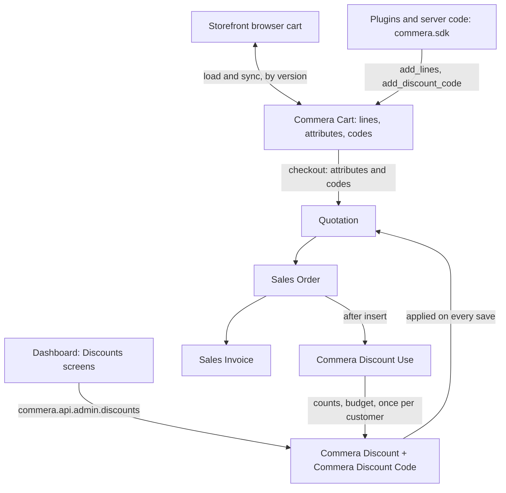

## Discount types and rules

| Area | Options |
| --- | --- |
| Method | Code (typed by the shopper, or many generated single-use codes) or Automatic |
| Type | Amount off products, Amount off order, Buy X get Y, Free shipping |
| Value | Percentage with an optional maximum ("10% off, up to ₹200"), fixed amount on each item or once per order, spend tiers for order discounts |
| Products | All, specific products, collections (with sub-collections) or brands; excluded products; skip items already on sale |
| Conditions | Minimum subtotal or item count; prepaid or cash on delivery only; everyone, first order only, or customer groups |
| Combinations | Combines with product, order and shipping discounts. Two discounts stack only when each allows the other |
| Limits | Total uses, once per customer (by customer, email or phone), budget (total discount given), start and end dates |
| Reporting | ERPNext Campaign and discount account |

An item is on sale when its sale price list rate is below its default price list rate.

## The discount step on each save

Quotation, Sales Order and Sales Invoice run the same two hooks from `commera/discounts/pricing.py`:

1. `before_validate` takes off the amounts the last save added. The result is clamped at zero, so other code that resets these fields cannot cause a double removal.
2. ERPNext prices the document: price lists, automatic Pricing Rules, taxes.
3. `validate` adds the discounts again:
    1. A storefront cart chooses its discounts: the shopper's codes first, then automatic discounts, each kept while its conditions hold and it combines with those already chosen. A Sales Order or Sales Invoice keeps the discounts its cart had.
    2. Product discounts: the best one on each line goes into the line `discount_amount`.
    3. Order discounts: they come off the subtotal after product discounts, into the document `discount_amount` with `apply_discount_on = Net Total`.
    4. The step writes `custom_discount_allocations`: one row per discount with its amount.

Shipping discounts change the delivery options after the plugin `delivery_options` hooks, so the price shown and the price charged are the same. The checkout's cash on delivery summary prices the cart again without prepaid-only discounts.

Each Sales Order logs one Commera Discount Use per discount when it is created. Cash on delivery orders stay draft, so the log does not wait for submit. Cancelling or deleting the order removes its uses.

## Server cart sync

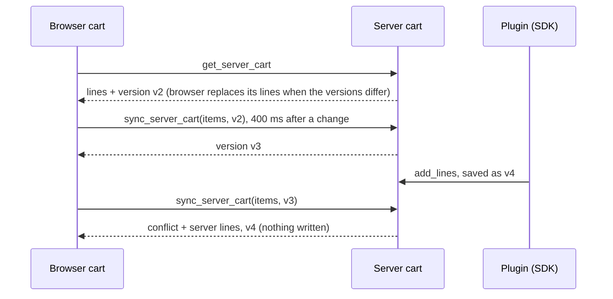

At checkout, quantities come from the browser, so a shopper can check out only the selected lines. The server cart adds each line's attributes and the codes.

## Dashboard

Discounts sits in the sidebar under Customers. The editor opens on Setup. Conditions, Limits and dates, and Reporting are separate tabs, and their optional sections stay collapsed with a one-line summary. The side panel shows the rules in words, the results as number cards, and a test cart priced on the server with the unsaved draft.

| Screen | Screenshot |
| --- | --- |
| List | 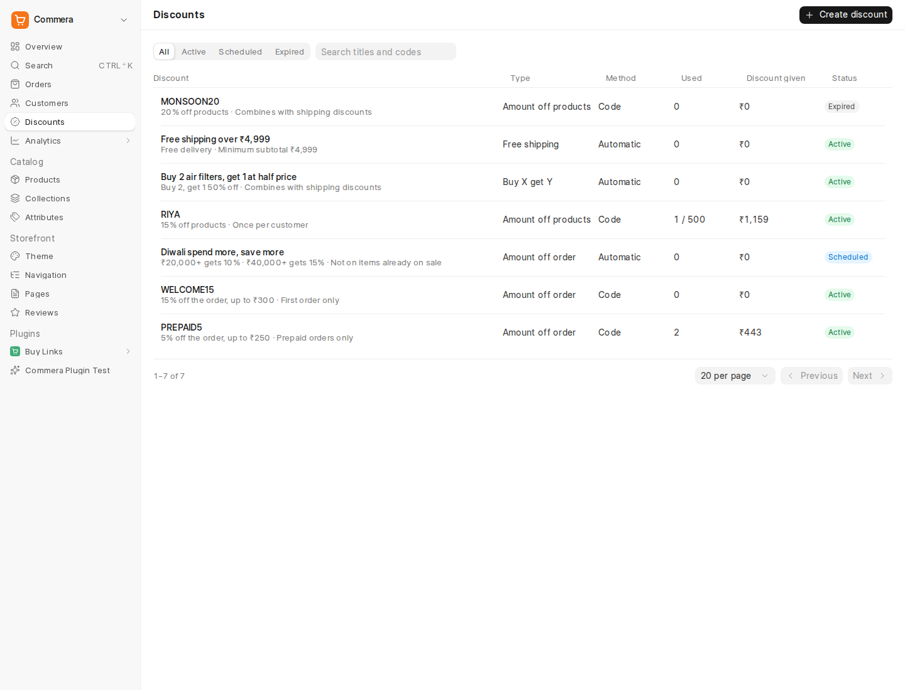 |
| Create | 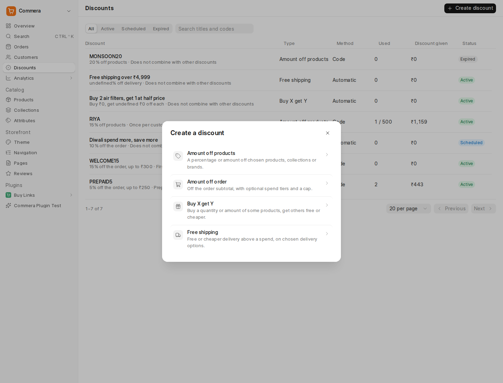 |
| Order code with a cap and a test cart | 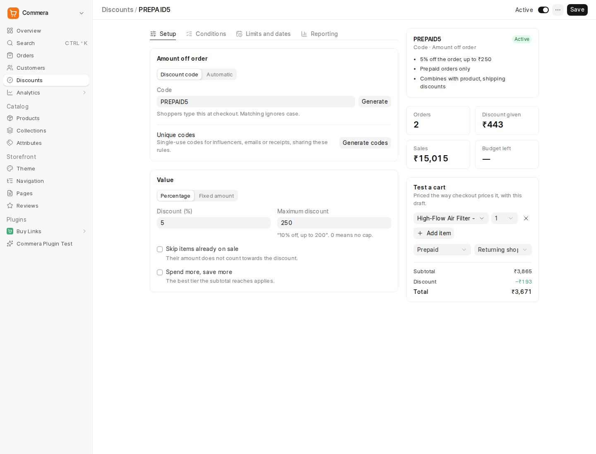 |
| Conditions, collapsed | 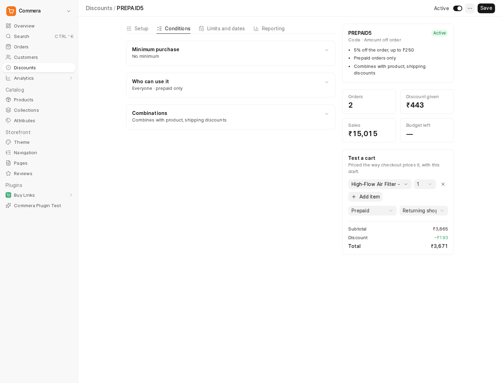 |
| Collection discount with unique codes and a budget | 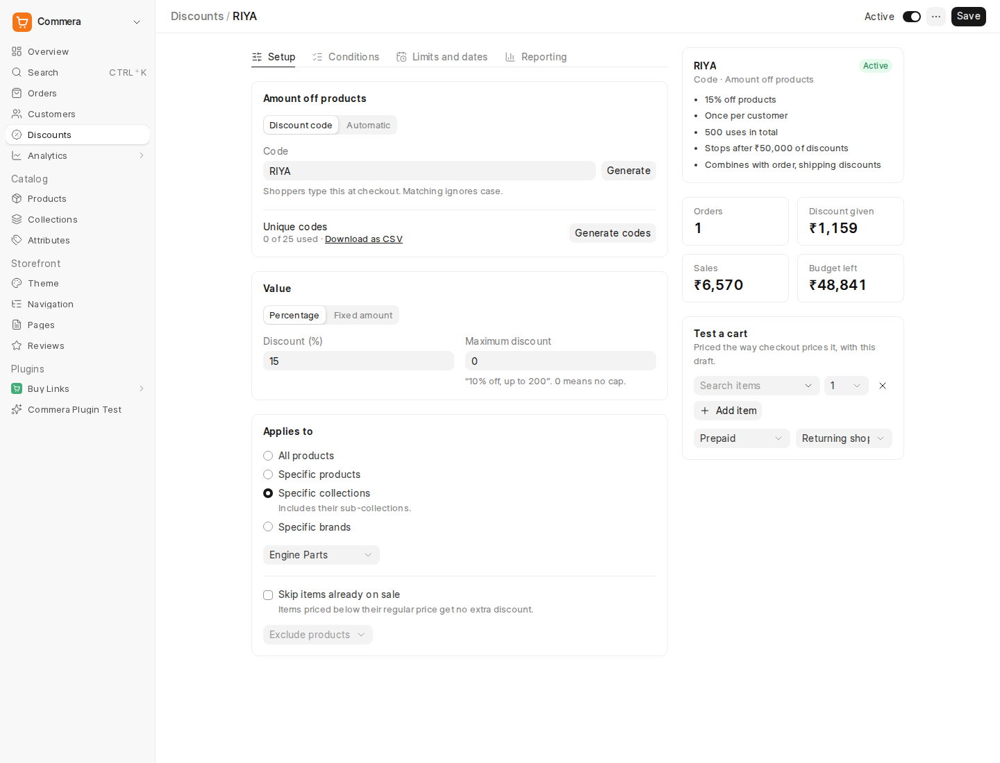 |
| Automatic spend tiers | 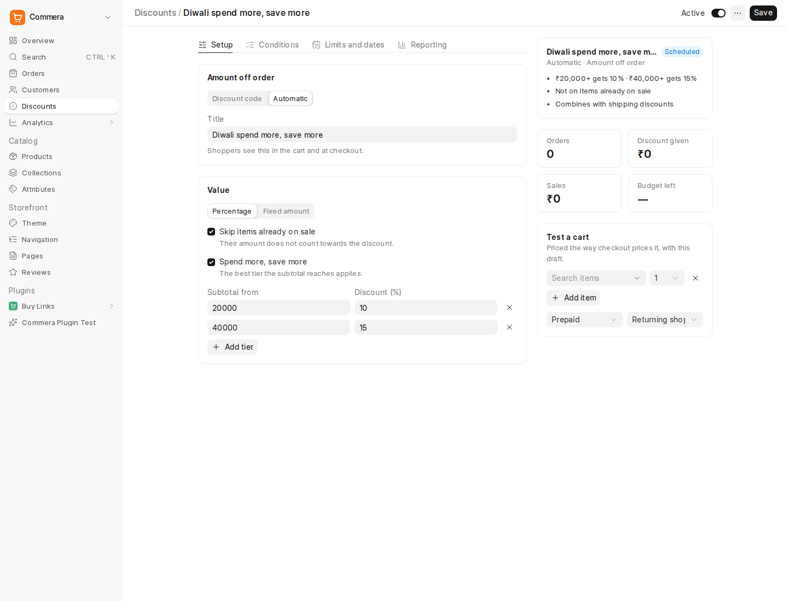 |
| Buy X get Y | 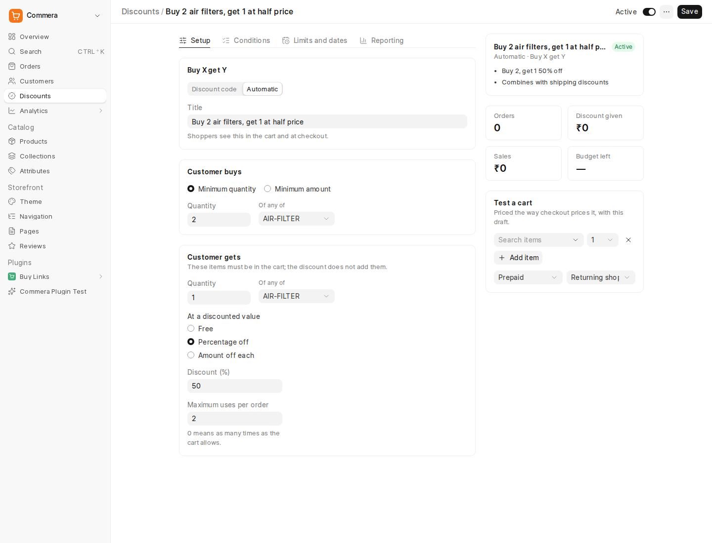 |
| Phone | 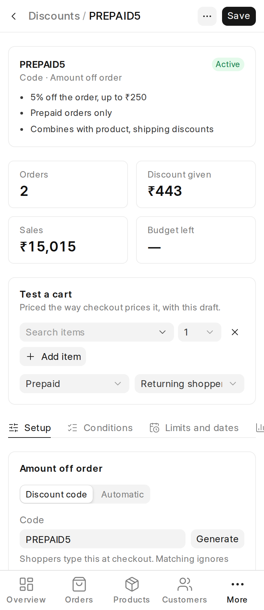 |
| Dark | 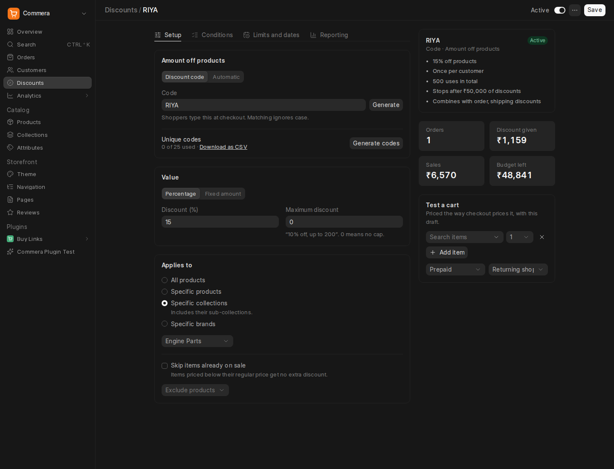 |

## SDK

`commera.sdk.discounts` writes with the caller's own permission on Commera Discount. Use `commera.sdk.as_plugin_user` when there is no user session, for example in a webhook.

```python
from commera.sdk import cart, discounts

created = discounts.create_discount(
	{"discount_type": "Amount Off Order", "value_type": "Percentage", "value": 10, "maximum_discount": 200},
	code="WELCOME10",
)
discounts.generate_codes(created["name"], 500, prefix="RIYA-")

# Show the amount before checkout, for example on a landing page.
preview = discounts.preview_cart([{"item_code": "SHIRT-M", "qty": 2}], codes=["WELCOME10"])

# Build the shopper's cart on the server; the storefront shows it on the next page load.
cart.add_lines([{"item_code": "RING-7", "qty": 1, "attributes": {"engraving": "A&B"}}])
cart.add_discount_code("WELCOME10")
```

| Module | Functions |
| --- | --- |
| `commera.sdk.discounts` | `create_discount`, `update_discount`, `get_discount`, `list_discounts`, `add_code`, `generate_codes`, `preview_cart`, `get_order_discounts` |
| `commera.sdk.cart` | `get_priced_cart`, `add_lines`, `update_lines`, `remove_lines`, `add_discount_code`, `remove_discount_code` (and the existing `get_cart`, `set_cart_fields`) |

## Records

| Doctype | Holds |
| --- | --- |
| Commera Discount | The rules, with child tables Commera Discount Target, Commera Discount Tier and Commera Discount Customer Group |
| Commera Discount Code | A code shoppers type, its discount, whether it was generated (single use) and its use count |
| Commera Discount Use | One row per discount per Sales Order: amount, order total, customer, email, phone |
| Commera Cart | The shopper's server cart, with Commera Cart Line rows |

Custom fields on Quotation, Sales Order and Sales Invoice (and their items) record the codes, each line's code amount and discount, the order and shipping discount, and the allocations.

## Not done yet

- The storefront checkout coupon box still applies one ERPNext coupon. A box for several Commera codes needs its own design.
- Usage limits are checked when a code is applied and when the cart is priced. Two orders placed at the same moment can both take the last use.
- The browser cart does not show line attributes, and a guest cart does not merge into the account cart at sign-in.
- No job removes old guest carts yet.
