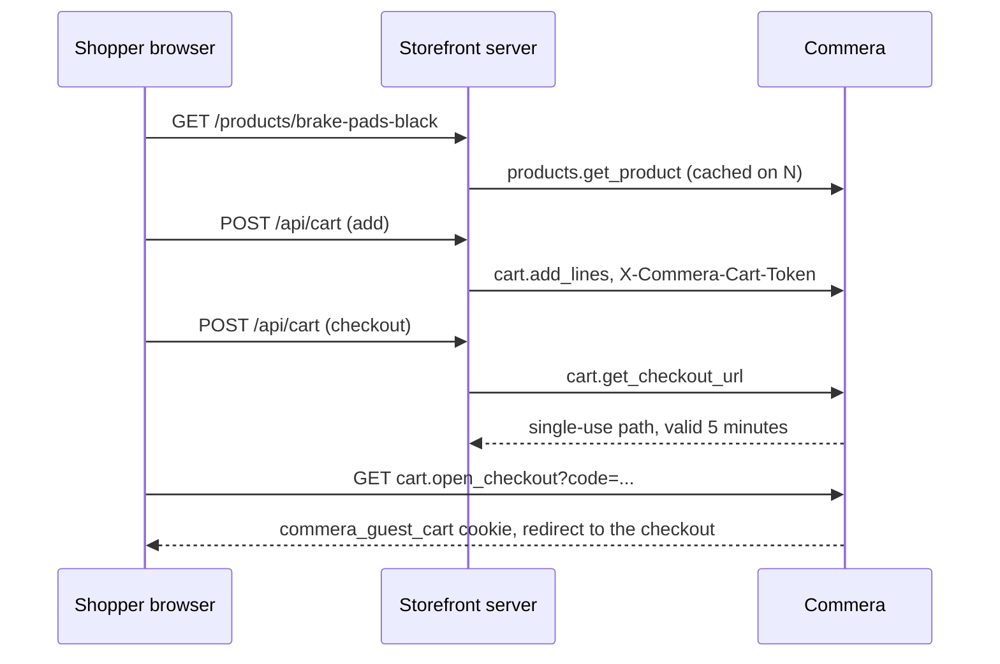
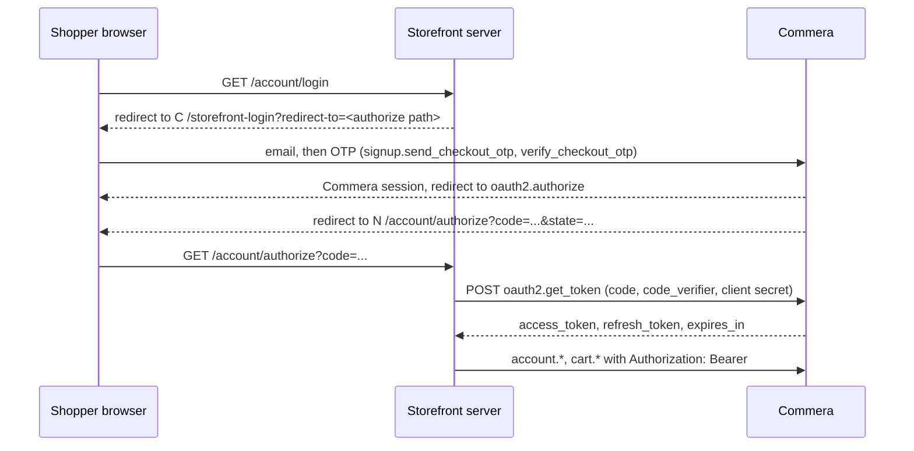

# Headless storefront API

`commera.api.storefront` serves the catalogue and the server cart to a storefront that runs on its own server, such as a Next.js app. Commera stays the owner of prices, stock, discounts, checkout, payments and customer accounts. The Jinja storefront does not use this API.

## One layer for every surface

The API is a thin layer over `commera.sdk`. It reads the request, calls the SDK, and answers HTTP 404 where the SDK returns None. Plugins call the same functions, so a plugin and a headless storefront see the same product, prices and cart.

| SDK function | Storefront API | Plugins | Jinja storefront |
| --- | --- | --- | --- |
| `catalog.list_products`, `catalog.get_product` | `products.get_products`, `products.get_product` | Yes | Not yet: the pages read `commera.utils` and `commera.product_detail`, which the SDK also uses |
| `catalog.list_collections`, `catalog.get_collection` | `collections.*` | Yes | Not yet |
| `shop.get_shop`, `shop.get_page`, `shop.get_sitemap` | `shop.*` | Yes | Not yet |
| `cart.get_priced_cart`, `add_lines`, `update_lines`, `remove_lines`, discount codes | `cart.*` | Yes | `commera.api.server_cart` |
| `catalog.get_items` | None | Yes | None |
| `account.get_profile`, `update_profile`, addresses, `list_orders`, `get_order` | `account.*` | Yes | Not yet: the account pages read `commera.utils` and `commera.www.account` |

The shapes are typed in `commera.sdk.types`: `ProductPage`, `ProductCard`, `Product`, `ProductVariant`, `Collection`, `Shop`, `MenuItem`, `ContentPage`, `Sitemap`, `PricedCart`, `CustomerProfile`, `CustomerAddress`, `ShopperOrder` and `ShopperOrderPage`. Each priced cart line has its `product` (handle, title, size and image). A menu item gives a link `type` and `target`, and the storefront API adds the headless path in `url`.

Plugin hooks run for headless carts too. `validate_discount_code` runs when a code is applied. `validate_cart`, `cart_fees`, `delivery_options` and `payment_methods` run on the Commera checkout, which a headless cart reaches through the hand-off.

```python
from commera.sdk import catalog, shop

page = catalog.list_products(collection="brake-system", sort="price_low", page_size=12)
product = catalog.get_product("brake-pads-black")  # None when it is not published
menu = shop.get_shop()["menu"]  # [{"title", "type": "collection", "target": "brake-system", "items"}]
```

## How it fits together



## Methods

The catalogue and cart methods allow guests. The [account methods](#account-methods) and `cart.adopt_cart` need a signed-in shopper. Reads are GET, writes are POST, and each method has its own rate limit.

| Method | Returns |
| --- | --- |
| `products.get_products` | One page of product cards with the facets of the whole result. Each brand, colour and size facet value has its product count, as `{"value": "K&N", "count": 3}`. The other selected filters narrow each count, but the facet's own filter does not. `price` is the `min` and `max` sale price. Filters: `collection`, `query`, `brands`, `colors`, `sizes`, `min_price`, `max_price`, `on_sale`. `sort` is `default`, `price_low`, `price_high`, `name`, `new_arrival` or `discount`. |
| `products.get_product` | One product: images, the colour option with sibling handles and stock, the size option, and one variant for each size with its price, list price and stock. |
| `collections.get_collections`, `collections.get_collection` | Item Groups that hold a published product. |
| `shop.get_shop` | Store name, currency, logo, the menu from Ecommerce Category, and the footer. |
| `shop.get_page` | A published Shop Web Page. |
| `shop.get_sitemap` | Handles and change dates of indexable products, collections and pages, 5000 for each kind on a page. Without arguments, it returns page 1 of each kind. Set `kind` to `products`, `collections` or `pages`, and `page` to get one kind and one page. `total` gives the number of handles of each returned kind, and `page_size` gives the page size. |
| `cart.get_cart`, `cart.add_lines`, `cart.update_lines`, `cart.remove_lines` | The priced server cart. Each line has the product handle, size and image. |
| `cart.add_discount_code`, `cart.remove_discount_code` | The priced cart, with a reason for each code that takes nothing off. |
| `cart.adopt_cart` | Signed in only. Moves the guest cart of the `X-Commera-Cart-Token` header into the account cart and returns the priced cart. |
| `cart.get_checkout_url` | `{"path": "/api/method/commera.api.storefront.cart.open_checkout?code=..."}` |

A missing or unpublished record returns HTTP 404. A product is one Style Attribute Variant: its `route` is the handle, sibling colours of the same configurator are the colour option, and its sizes are the variants. Options that only hold the fallback axis ("Title" or "One Size") are left out.

## The cart token

The storefront server keeps a random token of 32 to 128 letters, digits, `-` or `_`, and sends it with each call:

```sh
curl -X POST "$COMMERA/api/method/commera.api.storefront.cart.add_lines" \
  -H "X-Commera-Cart-Token: $TOKEN" -H "Content-Type: application/json" \
  -d '{"lines": [{"item_code": "BRAKE-PADS-BLA-Medium", "qty": 1}]}'
```

Commera stores the hash of the token as the guest cart key, the same as for the `commera_guest_cart` cookie, so discounts, stock caps, abandoned-cart cleanup and checkout work unchanged. `add_lines` refuses an item that no published product sells.

Guest methods are rate-limited by IP address. Frappe reads the first address in `X-Forwarded-For`, so the storefront server must send the shopper's IP there. Otherwise all shoppers share the server's limit.

## Checkout hand-off

`get_checkout_url` stores a random code in Redis for five minutes. For a guest cart the code holds the cart token. For a signed-in shopper the code holds the user. `open_checkout` reads the code:

- Guest cart, guest browser: it sets the `commera_guest_cart` cookie to the token and redirects to the checkout.
- Guest cart, signed-in browser: it merges the storefront cart into the account cart, as sign-in does.
- Signed-in shopper, browser signed in as the same user: it redirects to the checkout of the account cart.
- Signed-in shopper, any other browser: it keeps the code for five more minutes and redirects to `/storefront-login?prompt=login&redirect-to=<the open_checkout link>`. After sign-in, the browser opens the same link again. The checkout code never signs a browser in.
- A used or expired code redirects to the cart.

The code is used once, by the first browser that can use it.

After this, the shopper is on the Commera site. Payment, order confirmation and the account pages are Commera's.

## Customer accounts

A shopper signs in to the storefront with Commera's OTP sign-in and Frappe's OAuth2 provider. The storefront gets an access token and sends it to Commera as `Authorization: Bearer <access_token>`. Frappe sets the user from the token. It does not make a session.

### OAuth setup

In **Commera Settings > Storefront Apps > Headless Storefront**, set **Headless Storefront URL**, for example `https://shop.example.com`, and save. Commera creates or updates the OAuth Client in **Headless OAuth Client** with these values:

| Field | Value |
| --- | --- |
| App Name | `Commera Storefront` |
| Redirect URIs, Default Redirect URI | `<url>/account/authorize` |
| Scopes | `openid all` |
| Grant Type, Response Type | `Authorization Code`, `Code` |
| Skip Authorization | Yes |
| Allowed Roles | `Customer` |
| Token Endpoint Auth Method | `Client Secret Post` |

Give the Client ID and Client Secret of that OAuth Client to the storefront server. Keep the secret on the server. When you clear the URL, Commera keeps the OAuth Client.

### Sign-in flow



The storefront sends the browser to `/storefront-login?redirect-to=<path>`. The path is `/api/method/frappe.integrations.oauth2.authorize` with `client_id`, `response_type=code`, `scope=openid all`, `redirect_uri`, `state`, `code_challenge` and `code_challenge_method=S256`. URL-encode the path. `redirect-to` must be a path on the Commera site; any other value goes to `/`. A browser that is signed in already goes to the path at once. `prompt=login` shows the sign-in form to a signed-in browser too. The OTP sign-in creates the account when the email has none.

The storefront exchanges the code at `frappe.integrations.oauth2.get_token` with a form POST: `grant_type=authorization_code`, `code`, `redirect_uri`, `client_id`, `client_secret` and `code_verifier`. It refreshes with `grant_type=refresh_token`. At sign-out it calls `frappe.integrations.oauth2.revoke_token` with the refresh token. An invalid, expired or revoked token gets HTTP 401.

After sign-in, the storefront calls `cart.adopt_cart` once with the Bearer token and the guest cart token, then drops the guest cart token. Each later cart call sends only the Bearer token, so it acts on the account cart.

### Account methods

All account methods are in `commera.api.storefront.account`, need a signed-in shopper and are rate-limited for each user. A call without a valid token gets HTTP 401 or 403.

| Method | Parameters | Returns |
| --- | --- | --- |
| `get_profile` (GET) | None | `CustomerProfile` |
| `update_profile` (POST) | `first_name`, `last_name`, `phone`. A missing value is left as it is. | `CustomerProfile` |
| `list_addresses` (GET) | None | A list of `CustomerAddress` of the shopper's Customer |
| `save_address` (POST) | `address`: a `CustomerAddress` object. With `name`, it changes that address. Without `name`, it adds one. | `CustomerAddress` |
| `delete_address` (POST) | `name` | Nothing |
| `list_orders` (GET) | `page` (1), `page_size` (10, at most 50) | `{"orders", "total", "page", "page_size"}`, newest first |
| `get_order` (GET) | `name` | `ShopperOrder` |

```json
{"email": "asha@example.com", "first_name": "Asha", "last_name": "Menon", "full_name": "Asha Menon", "phone": "9876543210"}
```

```json
{"name": "Asha Menon-Shipping", "address_title": "Asha Menon", "address_type": "Shipping", "address_line1": "12 Harbour Road", "address_line2": null, "city": "Kochi", "state": null, "pincode": null, "country": "India", "phone": "9876543210", "email_id": null, "is_primary_address": false, "is_shipping_address": false}
```

`ShopperOrder` is the SDK `Order` without the staff `tags`. A shopper can change or delete only an address that they made. An address from a guest checkout shows in the list, but a change to it gets HTTP 404. An order of another shopper, or an order that does not exist, gets HTTP 404.

### Which orders a shopper sees

`list_orders` and `get_order` show:

- Orders that the shopper placed while signed in.
- Guest orders whose contact email is the shopper's email. A guest order is an order made from a guest cart. The OTP sign-in proved that the shopper owns the email.

An order that a signed-in account placed with the shopper's email is not the shopper's.

## Cache refresh

The storefront caches catalogue reads. Frappe **Webhook** records with **Enable Security** sign each request with `X-Frappe-Webhook-Signature`, so the storefront can expire the cache of the changed record. The storefront README lists the doctypes and request bodies.
