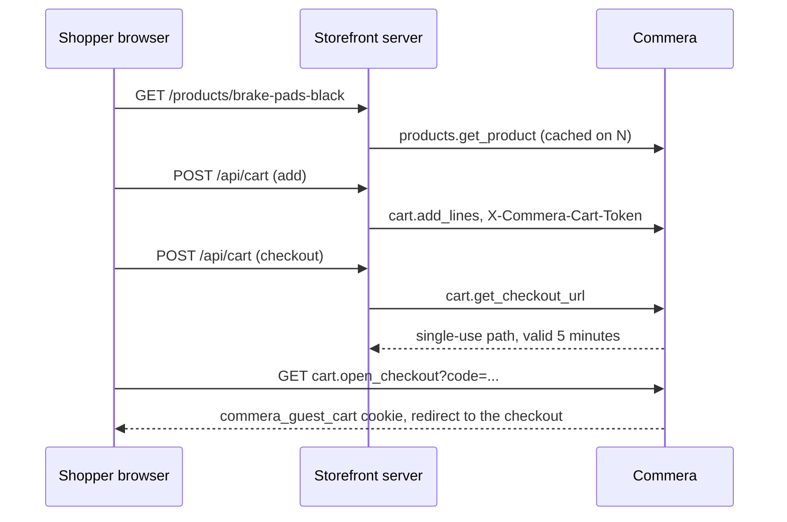

# Headless storefront API

`commera.api.storefront` serves the catalogue and the server cart to a storefront that runs on its own server, such as a Next.js app. Commera stays the owner of prices, stock, discounts, checkout, payments and customer accounts. The Jinja storefront does not use this API.

## One layer for every surface

The API is a thin layer over `commera.sdk`. It reads the request, calls the SDK, and answers HTTP 404 where the SDK returns None. Plugins call the same functions, so a plugin and a headless storefront see the same product, prices and cart.

| SDK function | Storefront API | Plugins | Jinja storefront |
| --- | --- | --- | --- |
| `catalog.list_products`, `catalog.get_product` | `products.get_products`, `products.get_product` | Yes | Not yet: the pages read `commera.utils` and `commera.product_detail`, which the SDK also uses |
| `catalog.list_collections`, `catalog.get_collection` | `collections.*` | Yes | Not yet |
| `shop.get_shop`, `shop.get_page`, `shop.get_sitemap` | `shop.*` | Yes | Not yet |
| `cart.get_priced_cart`, `add_lines`, `update_lines`, `remove_lines`, discount codes | `cart.*` | Yes | `commera.api.server_cart` |
| `catalog.get_items` | None | Yes | None |

The shapes are typed in `commera.sdk.types`: `ProductPage`, `ProductCard`, `Product`, `ProductVariant`, `Collection`, `Shop`, `MenuItem`, `ContentPage` and `PricedCart`. Each priced cart line has its `product` (handle, title, size and image). A menu item gives a link `type` and `target`, and the storefront API adds the headless path in `url`.

Plugin hooks run for headless carts too. `validate_discount_code` runs when a code is applied. `validate_cart`, `cart_fees`, `delivery_options` and `payment_methods` run on the Commera checkout, which a headless cart reaches through the hand-off.

```python
from commera.sdk import catalog, shop

page = catalog.list_products(collection="brake-system", sort="price_low", page_size=12)
product = catalog.get_product("brake-pads-black")  # None when it is not published
menu = shop.get_shop()["menu"]  # [{"title", "type": "collection", "target": "brake-system", "items"}]
```

## How it fits together



## Methods

All methods allow guests. Reads are GET, cart writes are POST, and each method has its own rate limit.

| Method | Returns |
| --- | --- |
| `products.get_products` | One page of product cards with the facets of the whole result. Filters: `collection`, `query`, `brands`, `colors`, `sizes`, `min_price`, `max_price`, `on_sale`. `sort` is `default`, `price_low`, `price_high`, `name`, `new_arrival` or `discount`. |
| `products.get_product` | One product: images, the colour option with sibling handles and stock, the size option, and one variant for each size with its price, list price and stock. |
| `collections.get_collections`, `collections.get_collection` | Item Groups that hold a published product. |
| `shop.get_shop` | Store name, currency, logo, the menu from Ecommerce Category, and the footer. |
| `shop.get_page` | A published Shop Web Page. |
| `shop.get_sitemap` | Handles and change dates of indexable products, collections and pages. |
| `cart.get_cart`, `cart.add_lines`, `cart.update_lines`, `cart.remove_lines` | The priced server cart. Each line has the product handle, size and image. |
| `cart.add_discount_code`, `cart.remove_discount_code` | The priced cart, with a reason for each code that takes nothing off. |
| `cart.get_checkout_url` | `{"path": "/api/method/commera.api.storefront.cart.open_checkout?code=..."}` |

A missing or unpublished record returns HTTP 404. A product is one Style Attribute Variant: its `route` is the handle, sibling colours of the same configurator are the colour option, and its sizes are the variants. Options that only hold the fallback axis ("Title" or "One Size") are left out.

## The cart token

The storefront server keeps a random token of 32 to 128 letters, digits, `-` or `_`, and sends it with each call:

```sh
curl -X POST "$COMMERA/api/method/commera.api.storefront.cart.add_lines" \
  -H "X-Commera-Cart-Token: $TOKEN" -H "Content-Type: application/json" \
  -d '{"lines": [{"item_code": "BRAKE-PADS-BLA-Medium", "qty": 1}]}'
```

Commera stores the hash of the token as the guest cart key, the same as for the `commera_guest_cart` cookie, so discounts, stock caps, abandoned-cart cleanup and checkout work unchanged. `add_lines` refuses an item that no published product sells.

Guest methods are rate-limited by IP address. Frappe reads the first address in `X-Forwarded-For`, so the storefront server must send the shopper's IP there. Otherwise all shoppers share the server's limit.

## Checkout hand-off

`get_checkout_url` stores the token under a random code in Redis for five minutes. `open_checkout` reads the code once:

- For a guest browser, it sets the `commera_guest_cart` cookie to the token and redirects to the checkout.
- For a signed-in browser, it merges the storefront cart into the account cart, as sign-in does.
- A used or expired code redirects to the cart.

After this, the shopper is on the Commera site. Payment, order confirmation and the account pages are Commera's.

## Cache refresh

The storefront caches catalogue reads. Frappe **Webhook** records with **Enable Security** sign each request with `X-Frappe-Webhook-Signature`, so the storefront can expire the cache of the changed record. The storefront README lists the doctypes and request bodies.
